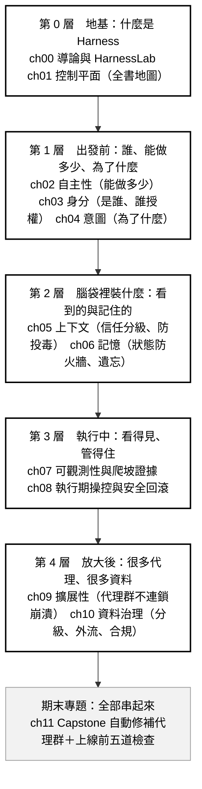
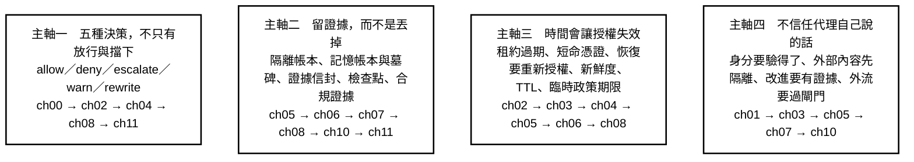

# K142 知識地圖：一張圖看懂《Harness Engineering：長時程多代理 AI 系統的安全設計模式》

> Ken Huang 等著，英文原名 *Harness Engineering: Design Patterns for Securing Long-Horizon Multi-Agent AI Systems*。
> 本文是依各章重點整理的架構導讀，不含書籍原文。2026-11-22 整理；章節編號沿用本 repo 的 ch00–ch11。
> 書附實驗室 HarnessLab（作者公開、純 Python、零相依、不需 API 金鑰），每章一個可執行情境，是全書的「實驗課」。

## 一、全書一句話定位

**正式上線的多代理 AI 系統，決定安不安全的不是提示詞、也不是模型，而是包在模型外面的那一層控制平面——Harness。**

Harness 本意是「馬具／安全帶」：不是被動包住模型的外殼，而是用來約束、引導、傳導力量的結構。
它決定代理能知道什麼、記住什麼、做什麼決定、把權限委派給誰、執行什麼、被誰看見、出事怎麼恢復。

書名裡有兩個「放大器」：

- **長時程**：跑得愈久，世界變化愈多（新政策、新留言、舊記憶過期、從檢查點恢復時目的已變）。
- **多代理**：代理愈多，權限與上下文就愈容易互相傳染（共用憑證、共用工作區、連鎖重試）。

## 二、為什麼這本書看起來像一串「控制清單」

翻目錄會看到：自主性、身分、意圖、上下文、記憶、可觀測性、執行期操控、擴展性、資料治理……
像九個互不相干的資安主題。其實全書有一條很清楚的主線，順著「一個代理從被派出去到上線」的時間軸排列：

**先定義什麼是 Harness → 出發前決定「誰、能做多少、為了什麼」→ 管住它「看到什麼、記住什麼」→ 執行中「看得見、管得住」→ 放大到「很多代理、很多資料」→ 最後全部串成一個可上線的系統。**

## 三、全書架構：五層樓＋一個期末專題

| 層 | 章節 | 這一層要回答的問題 | 一句話 |
| --- | --- | --- | --- |
| 0 地基 | ch00–01 | Harness 是什麼？要做到哪些事？ | 只能信任到「工作有經過 harness」的程度 |
| 1 出發前 | ch02–04 | 誰在做？能做多少？為了什麼做？ | 自主是梯子、身分要驗得了、授權依目的 |
| 2 腦袋 | ch05–06 | 代理看到什麼、記住什麼？ | 上下文就是權限、記憶就是未來的行為 |
| 3 執行中 | ch07–08 | 做了什麼看得見嗎？跑歪了管得住嗎？ | 沒有證據就是「軌跡劇場」；介入要分級、要可回滾 |
| 4 放大 | ch09–10 | 很多代理、很多資料時還安全嗎？ | 協調本身就是安全控制；資料標籤跟著資料跑 |
| 期末 | ch11 | 全部接起來能上線嗎？ | 六道閘門＋五道上線前檢查 |

## 四、各層核心概念與彼此關係

### 第 0 層　地基（ch00–01）

- **Harness 的七件事**：叫得出每個行動者、把行動綁定目的、替資料分級、檢查工具權限、留下證據、暫停高風險執行、從檢查點恢復。後面九章就是把這七件事一件一件拆開講。
- **五種決策**：每一道控制的輸出只有 allow（放行）、deny（擋下）、escalate（交給人）、warn（繼續但警示）、rewrite（改寫成安全版本）。全書每章都在練習「這個情況該給哪一種」。
- **爬坡（hill climbing）**：長時程代理在計畫、工具、程式、上下文之間做局部搜尋；搜尋有價值，但要「有邊界、看得見、可回退、有證據」。
- **反面教材**：ch01 的 `shared-deploy-swarm`——四個代理共用一組大權限憑證、共用工作區讀外部留言、人人都能推正式環境。後面每一章修掉其中一個洞。

### 第 1 層　出發前（ch02–04）：三個問題，三把鎖

| 章 | 問題 | 核心工具 | 與其他章的關係 |
| --- | --- | --- | --- |
| ch02 自主性 | 能做多少？ | 自主梯子、能力預算、核准佇列、不可豁免控制、可回退掛勾、會過期的租約 | 「交給人」的出口，ch08 介入、ch11 部署核准都用它 |
| ch03 身分 | 是誰？誰授權的？ | 每代理＋每任務一個身分、短命且綁受眾的憑證、委派鏈、立即撤銷、恢復後換新憑證 | ch11 第一道閘門；ch09 撤銷被入侵工作者的租約 |
| ch04 意圖 | 為了什麼？ | 意圖合約（目的、工具、資料、風險上限、證據、何時重新授權）、偏移偵測、依目的授權 | 決定 ch05 哪些上下文相關、ch10 哪些資料可用 |

關係：**身分回答「誰」、意圖回答「為什麼」、自主性回答「能做到哪一階」**。三者缺一，代理就會拿著合法憑證、做著不合目的的事，或是一次核准用到天荒地老。

### 第 2 層　腦袋裡裝什麼（ch05–06）

- **ch05 上下文＝權限**：上下文會改變代理相信什麼、用哪個工具、把資料送去哪。每段上下文帶信任等級（系統→租戶→可信工具→使用者→外部→隔離）、來源與新鮮度；外部內容先隔離，可疑的進「隔離帳本」留證據而不是直接丟掉。
- **致命三要素**：私有資料＋不可信內容＋對外送出能力同時出現，最危險，必須在送出前擋下（ch10 外流閘門是它的落地版）。
- **ch06 記憶＝未來的行為**：今天寫進去的一句話，明天會變成規則。寫入要過「狀態防火牆」、每筆進帳本（來源雜湊、政策版本、租戶、存活時間）、交接要經過提升流程。
- **三種遺忘**：到期失效（TTL）、回滾留墓碑（tombstone，標記原因、不抹掉紀錄）、租戶完全隔離。

關係：**ch05 管「這一輪看到什麼」，ch06 管「哪些東西會活到下一輪」**。注入攻擊若在 ch05 沒擋住，就會在 ch06 變成長期污染。

### 第 3 層　執行中（ch07–08）

- **ch07 可觀測性**：要回答「做了什麼、為什麼、根據什麼證據、改動讓系統更安全還是更危險」。工具：決策軌跡（trace span，先遮蔽再寫入）、證據信封（evidence envelope，把軌跡、產物雜湊、政策版本綁成防竄改雜湊）、重播包（replay bundle）。
- **爬坡評估閘門**：候選改進就算更快、成功率更高，只要安全指標退步就擋下；自我改進沒有證據與回滾不准上線。
- **ch08 執行期操控**：處理「已經在跑」的代理。介入動詞分級：觀察→警示→暫停→阻擋→終止→隔離→恢復，像斷路器逐級升高；暫停前先存檢查點；臨時政策要有期限；已做的可逆動作用補償回滾。

關係：**ch07 是眼睛、ch08 是手**。沒有 ch07 的證據，ch08 恢復時不知道從哪裡接、重播時不知道發生過什麼。

### 第 4 層　放大後（ch09–10）

- **ch09 擴展性**：代理群的協調本身就是安全控制。工具：租戶隔艙（bulkhead）、全域並行上限與反壓、容量配額、流量窗口、冪等鍵（重試不重複副作用）、隔離被入侵的工作者、依時段（epoch）分配容量。
- **ch10 資料治理**：政策要變成執行期控制。資料帶分級標籤（公開、內部、機密、個資、秘密、受法規管制）跑過每個工具、模型、記憶與軌跡；路由看模型設定檔與地區；外流閘門看白名單與地區；恢復時標籤不能遺失；刪除要同時涵蓋記憶與軌跡並留合規證據。

關係：**ch09 防的是「量」造成的崩潰，ch10 防的是「資料」跑錯地方**。兩者都是把第 1～3 層的單一代理控制，放大到多租戶、多模型、多地區。

### 期末專題（ch11）：六道閘門對回前面各章

| Capstone 閘門 | 來自哪一章 |
| --- | --- |
| 綁受眾的憑證（分流代理的憑證不能拿去部署） | ch03 身分 |
| 上下文隔離（回報裡的注入先清掉再交給修補代理） | ch05 上下文 |
| 意圖合約（只能動相關檔案，碰驗證或計費檔立刻警示） | ch04 意圖 |
| 記憶帳本（成功摘要提升進記憶、失敗實驗打墓碑） | ch06 記憶 |
| 人類核准閘門（部署要明確核准憑證） | ch02 自主性 |
| 可驗證的稽核信封（回報、diff、測試、部署收據的雜湊） | ch07 可觀測性 |

**上線前五道檢查**：身分與委派、意圖與目的、上下文與隔離、狀態與回滾、治理與證據——作者稱之為「給代理群正式自主權之前」的客觀門檻。

## 五、貫穿全書的四條主軸（真正的骨架）

章節是橫的，這四條是縱的。抓住它們，12 章就串起來了：

1. **五種決策**：真實世界很少是黑白的。寄客戶信可以「改寫」成內部紀錄（ch04）、超出配額可以「升級」給人（ch09）、輕微偏移可以「警示」後繼續。會用中間三種，系統才不會在「全擋」與「全放」之間二選一。
2. **留證據**：可疑內容進隔離帳本、記憶回滾留墓碑、介入前存檢查點、刪除留合規證據。出事時要能重播、稽核時要能證明。
3. **時間會讓授權失效**：長時程最大的風險是「當初的核准，現在還算數嗎？」所以憑證短命、租約會過期、記憶有 TTL、恢復執行時目的若變了要重新授權。
4. **不信任代理自己說的話**：模型說「我是修補代理」不算數、網頁說「以後都刷這張卡」不算數、候選改進說「我更好」不算數——都要由 harness 的程式碼與證據來判斷。

## 六、關鍵術語表

| 術語 | 白話解釋 | 主要章節 |
| --- | --- | --- |
| Harness（控制平面） | 包在模型外面、決定代理能看、能記、能做什麼的那層結構 | ch00、ch01 |
| 長時程（long-horizon） | 代理連續執行很久、跨越多次檢查點與恢復 | ch01、ch04、ch08 |
| HarnessLab | 作者的實驗室 repo，每章一個情境，輸出 `LabResult`（decisions＋artifacts） | ch00 起每章 |
| 五種決策 | allow／deny／escalate／warn／rewrite | ch00 |
| 爬坡（hill climbing） | 代理做局部搜尋改進；要有邊界、看得見、可回退、有證據 | ch01、ch07 |
| 自主梯子 | 唯讀→受監督寫入→特權執行，每階權限與核准不同 | ch02 |
| 能力預算 | 每種工具、每種風險各能用幾次 | ch02 |
| 不可豁免控制 | 就算有人說「這次例外」也不放行的規則 | ch02 |
| 租約（lease） | 會過期的授權，到期要續約 | ch02、ch09 |
| 委派鏈 | 人→規劃代理→子代理，一路記下誰授權給誰 | ch03 |
| 受眾綁定（audience） | 憑證只能用在指定對象，拿去別處就失效 | ch03、ch11 |
| 意圖合約 | 寫明目的、工具、資料、風險上限、證據、何時重新授權 | ch04 |
| 意圖偏移（drift） | 代理逐漸偏離原本核准的目的 | ch04 |
| 信任等級／來源（provenance） | 每段上下文標記可信程度與出處 | ch05 |
| 隔離帳本（quarantine） | 可疑內容不丟掉、隔離並留證據 | ch05 |
| 致命三要素 | 私有資料＋不可信內容＋對外送出能力同時出現 | ch05、ch10 |
| 狀態防火牆 | 記憶寫入前的閘門 | ch06 |
| 提升（promotion） | 交接摘要經審核才進長期記憶 | ch06、ch11 |
| 墓碑（tombstone） | 回滾時標記失效原因、不抹掉紀錄 | ch06 |
| TTL | 記憶的存活時間，到期自動失效 | ch06 |
| 決策軌跡（trace span） | 每個控制判斷的紀錄，寫入前先遮蔽敏感內容 | ch07 |
| 證據信封（evidence envelope） | 把軌跡、產物雜湊、政策版本綁成防竄改雜湊 | ch07、ch11 |
| 重播包（replay bundle） | 讓稽核者重現當時判斷的資料包 | ch07、ch08 |
| 軌跡劇場 | 只有漂亮圖表與 token 數、沒有決策證據的假可觀測性 | ch07 |
| 斷路器式介入 | 觀察→警示→暫停→阻擋→終止→隔離→恢復 | ch08 |
| 臨時政策（policy overlay） | 執行中注入、有期限的政策 | ch08 |
| 補償（compensation） | 用反向動作回滾已執行的可逆動作 | ch08 |
| 隔艙（bulkhead） | 租戶之間像船的水密艙，一個爆了不拖垮別人 | ch09 |
| 反壓（back-pressure） | 滿載時讓上游排隊，而不是硬塞 | ch09 |
| 冪等鍵 | 同一請求重試只生效一次；同鍵不同內容要擋 | ch09 |
| 分級標籤 | 公開、內部、機密、個資、秘密、受法規管制 | ch10 |
| 外流閘門（egress） | 對外送出前檢查白名單、地區、疑似秘密 | ch10 |
| 合規證據工廠 | 把資料治理的每個判斷都自動留下可交給稽核的證據 | ch10 |
| Capstone 修補代理群 | 分流→修補→部署三代理的期末參考實作 | ch11 |

## 七、閱讀路線建議

### 路線 A：三遍讀法（推薦，第一次讀）

1. **第一遍只讀第 0 層（ch00–01）**：記住「Harness 七件事」與「五種決策」，並跑一次 HarnessLab 的 `run all`，只看 JSON 輸出、不看程式碼。這兩章是全書的地圖。
2. **第二遍直接跳 ch11 Capstone**：看六道閘門長什麼樣子，再依上面的對照表倒推回 ch02–ch07 各讀一章。這樣每一章都有「它在期末專題裡負責哪一道門」的位置感。
3. **第三遍讀第 4 層（ch09–10）與 ch08**：這三章處理的是正式環境才會遇到的問題（流量、資料地區、事故中途注入政策），最後用上線前五道檢查替自己的系統打分數。

### 路線 B：依你的角色挑章

| 你是 | 優先讀 | 原因 |
| --- | --- | --- |
| 寫代理程式的工程師 | ch02、ch04、ch05、ch08 | 權限梯子、目的合約、防注入、執行中介入是每天會寫到的 |
| 平台／SRE | ch03、ch07、ch09 | 身分與憑證、可觀測性、代理群容量與反壓 |
| 資安／稽核 | ch05、ch06、ch07、ch10 | 防投毒、記憶污染、證據信封、外流與合規 |
| 主管／決策者 | ch01、ch02、ch11 | 控制平面概念、人類監督的位置、上線門檻 |

### 每章的固定讀法（作者建議）

**跑 → 看 → 擴充 → 檢討**：先跑該章情境、只看 decisions 與 artifacts，找出哪個決策是危險路徑、哪個產物是稽核人員會在意的；再看 scenario.py 找出改變結果的那道控制；然後自己加一個情境戳邊界；最後對照該章附的 LabResult 檢討差異。

> 一句話記住整本書：**誰在做要驗、為什麼做要綁、看到的要分級、記住的要過閘、做過的要留證、跑歪的要能停、放大了也要隔艙。**

## 八、對照：換成 Claude Code 怎麼做

| 書中概念 | Claude Code 對應 |
| --- | --- |
| 自主梯子／核准佇列 | 權限模式（plan／預設／acceptEdits）與每次工具呼叫的核准提示 |
| 不可豁免控制 | `settings.json` 的權限 deny 清單、PreToolUse hook 直接 block |
| 身分與委派鏈 | 主代理→子代理（sub-agent），各自限定工具清單 |
| 意圖合約 | `CLAUDE.md` 寫明任務範圍與禁止事項；子代理 prompt 明訂目的 |
| 上下文隔離 | 處理不可信內容時用 `--strict-mcp-config`、關掉工具的 `claude -p` |
| 狀態防火牆／記憶 | 記憶檔與 `CLAUDE.md` 的寫入審查 |
| 決策軌跡／重播 | session 記錄（jsonl）、hooks 的事件紀錄 |
| 執行期介入 | 中途按 Esc 中斷、`/rewind` 回到檢查點 |
| 隔艙／並行上限 | git worktree 隔離多個 session、限制同時派出的子代理數 |
